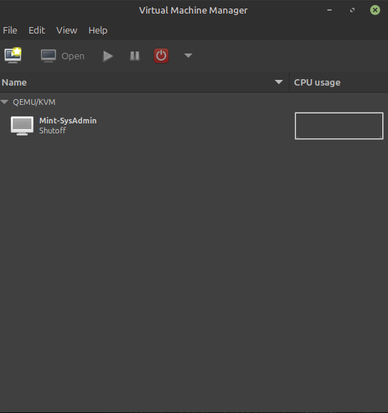
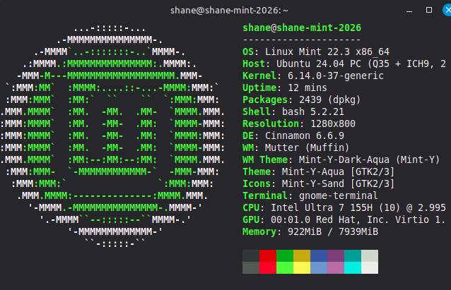

# __<ins>Linux Mint VM Install</ins>__

## Shane Ferlicka 09/02/2026

My choice of a linux distro was Ubuntu Linux Mint Cinnomon Edition and I used KVM with Virt-Manager for my Linux laptop.

 

## Downloading ISO File and Creation of VM
I started off downloading the .ISO file from a US server and check the hashes to verify the legitmacy of the download before running on my VM Manager. probally important as a systems administrator 
 
                    
Image of VM Manager with VM inside

## Installation of Linux Mint onto VM Disk

I installed this by clicking the disklette in the top left hand corner, then clicking bottons like they asked. I chose not to encrypt my home folder and wanted those muilti media codexs.

I also restrted my computer after the full install of 

Since that was simple and nothing crashed yet I ran my updates and while that ran I changed my keybins to windows+L into my lock and changed my time till suspend and lock. Time well used

Image of my install command >:0

I also auto removed and forgot to screen shot it

## Downlaods and Finish

I downloaded the random programs we were told to and did not check what any of them were before installing them! 

Proof of task below

And to leave it I ran Neofetch for the ASCII art and specs of my VM

Properly turned off my VM and went to bed.

__Please let me know any improvments on things to add or take out.__

 &nbsp;&nbsp;&nbsp;&nbsp; _  
  &nbsp;_(&nbsp;&nbsp;.)<   
 (\_ _)    

 Weird duck?

  

